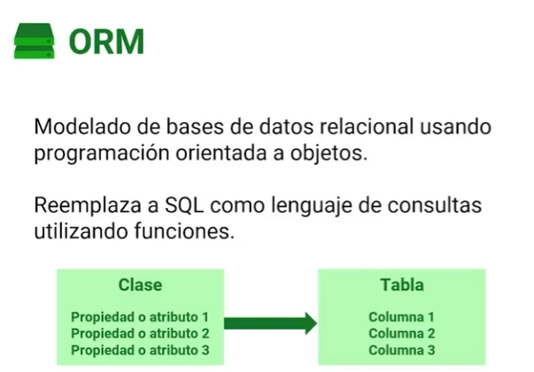

# ADO.NET, ORMs y EF Core

## En una frase

ADO.NET es la capa de .NET que abre conexiones y ejecuta SQL; un ORM como EF Core se apoya en ella para traducir entre filas y objetos, y te ahorra el mapeo repetitivo, pero **no** te ahorra entender SQL ni te vuelve inmune a la inyección SQL.

-----

## Antes de empezar

Conviene que ya sepas:

* Clases y propiedades: [POO](../../01-csharp-core-and-runtime/04-poo/README.md).
* LINQ: [Introducción a LINQ](../../01-csharp-core-and-runtime/07-linq/01-Introduccion%20a%20LINQ.md).
* `async`/`await`: [Asincronía](../../01-csharp-core-and-runtime/10-asincronia-y-archivos/README.md).

Palabras nuevas (también están en el [Glosario](Glosario.md)):

* **ADO.NET:** conjunto de tipos de .NET (`DbConnection`, `DbCommand`, `DbDataReader`) para conectarse a una base y ejecutar SQL.
* **Proveedor ADO.NET:** implementación de esos tipos para un motor concreto (`Microsoft.Data.SqlClient`, `Microsoft.Data.Sqlite`, `Npgsql`).
* **ORM (*Object-Relational Mapper*):** biblioteca que traduce entre objetos del programa y tablas relacionales.
* **Micro-ORM:** biblioteca que solo convierte resultados de SQL escrito a mano en objetos, como Dapper.
* **Inyección SQL (*SQL injection*):** ataque en el que un dato del usuario termina interpretado como parte de la sentencia SQL.
* **Consulta parametrizada:** sentencia en la que los valores viajan aparte del texto SQL, como parámetros.

-----

## El problema

Una aplicación de tareas busca por título con ADO.NET "a pelo":

```csharp
var cmd = conexion.CreateCommand();
cmd.CommandText = $"SELECT Id, Titulo FROM Tareas WHERE Titulo = '{tituloBuscado}'";

using var reader = cmd.ExecuteReader();
while (reader.Read())
{
    tareas.Add(new Tarea { Id = reader.GetInt32(0), Titulo = reader.GetString(1) });
}
```

Funciona en la demo. Después pasan tres cosas:

1. Un usuario escribe en el buscador `x' OR '1'='1`. La sentencia queda `WHERE Titulo = 'x' OR '1'='1'` y devuelve **todas** las tareas, incluidas las de otros usuarios. Con `'; DROP TABLE Tareas; --` el daño es peor.
2. Alguien agrega la columna `Prioridad` en medio del `SELECT`. `reader.GetString(1)` ahora lee la prioridad, que es un número: `InvalidCastException`.
3. La misma conversión fila → objeto se repite en cada consulta del proyecto. Cada copia es un lugar más donde equivocarse de índice o de tipo.

Las consecuencias:

* datos expuestos o destruidos por concatenar texto del usuario;
* código frágil que se rompe al reordenar columnas;
* cientos de líneas de mapeo manual que no aportan nada al negocio.

-----

## Cómo funciona

### 1. La arquitectura: quién habla con la base


```text
Navegador / app móvil ──HTTP──► Backend (.NET) ──ADO.NET──► Base de datos
        muestra                    procesa                      guarda
```

El cliente **nunca** se conecta a la base: no puede guardar credenciales de forma segura y cualquiera podría ejecutar lo que quisiera. Solo el backend tiene la cadena de conexión y decide qué consultas se ejecutan.

### 2. ADO.NET: la capa de abajo


ADO.NET define clases abstractas y cada motor aporta su proveedor:

| Abstracción | SQL Server | SQLite | PostgreSQL |
| --- | --- | --- | --- |
| `DbConnection` | `SqlConnection` | `SqliteConnection` | `NpgsqlConnection` |
| `DbCommand` | `SqlCommand` | `SqliteCommand` | `NpgsqlCommand` |
| `DbDataReader` | `SqlDataReader` | `SqliteDataReader` | `NpgsqlDataReader` |
| Paquete | `Microsoft.Data.SqlClient` | `Microsoft.Data.Sqlite` | `Npgsql` |

El flujo siempre es el mismo: abrir conexión → crear comando → ejecutar → leer filas → cerrar. ADO.NET **no** "sabe conectarse a cualquier base" por sí solo: sin el proveedor del motor no hay conexión posible.

### 3. Parámetros: la defensa real contra la inyección

```csharp
cmd.CommandText = "SELECT COUNT(*) FROM Tareas WHERE Titulo = $titulo";
cmd.Parameters.AddWithValue("$titulo", tituloBuscado);
```

El motor recibe el texto SQL y el valor **por separado**. El valor nunca se interpreta como código, contenga lo que contenga. Esto es lo que protege, no el uso de un ORM.

### 4. ORM: de filas a objetos




| Base de datos | C# |
| --- | --- |
| Tabla `Tareas` | Clase `Tarea` (expuesta como `DbSet<Tarea> Tareas`) |
| Columna `Titulo` | Propiedad `Titulo` |
| Fila | Instancia de `Tarea` |
| Clave foránea `CategoriaId` | Propiedad `CategoriaId` + navegación `Categoria` |

Con EF Core, la consulta del problema queda:

```csharp
List<Tarea> tareas = await db.Tareas
    .Where(t => t.Titulo == tituloBuscado)
    .ToListAsync();
```

EF Core traduce el LINQ a SQL **parametrizado**, lo ejecuta con ADO.NET y crea los objetos. El mapeo por nombre de columna hace que reordenar columnas no rompa nada.

```text
LINQ ──► EF Core (traduce a SQL + parámetros) ──► proveedor ADO.NET ──► motor
                                                                          │
objetos ◄── EF Core (materializa filas) ◄── DbDataReader ◄────────────────┘
```


### 5. Un ORM no te hace inmune

EF Core también permite SQL escrito a mano. Ahí vuelve el riesgo:

| Método | Qué hace con `{valor}` | ¿Seguro? |
| --- | --- | --- |
| `FromSql($"... {valor}")` | Lo convierte en parámetro | ✔ |
| `FromSqlRaw("... {0}", valor)` | Lo convierte en parámetro | ✔ |
| `FromSqlRaw($"... '{valor}'")` | Concatena el texto antes de que EF Core lo vea | ❌ |

EF Core 8 agregó la advertencia **EF1002** para el tercer caso, pero es solo una advertencia: compila igual.

### 6. Familia de herramientas de acceso a datos en .NET

| Herramienta | Qué hace | Cuándo brilla | Qué cuesta |
| --- | --- | --- | --- |
| ADO.NET | Ejecuta SQL y entrega filas | Control total, casos muy específicos | Mapeo manual, mucho código |
| Dapper (micro-ORM) | Tu SQL → objetos | Consultas de lectura muy afinadas | Escribes y mantienes todo el SQL; no rastrea cambios |
| EF Core (ORM) | LINQ → SQL, cambios → `INSERT`/`UPDATE`/`DELETE`, migraciones | CRUD, modelo relacional que evoluciona con el código | Hay que entender qué SQL genera; abstracción con costo |

No son excluyentes: un proyecto puede usar EF Core para la mayoría de los casos y Dapper o SQL explícito en dos consultas críticas, **medidas**.

### 7. EF6 frente a EF Core

| | Entity Framework 6 | EF Core |
| --- | --- | --- |
| Origen | 2008, para .NET Framework | 2016, reescrito desde cero |
| Plataforma | .NET Framework; desde 6.3 también corre en .NET Core 3.0+ | .NET moderno (Windows, Linux, macOS) |
| Estado | Mantenimiento: correcciones, sin funciones nuevas | Una versión principal por año, junto con .NET |
| Uso hoy | Mantener aplicaciones existentes | Todo proyecto nuevo |

No es solo "uno viejo y uno nuevo": EF Core no es una versión 7 de EF6, sino otra biblioteca con otra API. Migrar de uno a otro es un proyecto, no una actualización de paquete.

### 8. Tipos de columna que verás en SQL Server

| Propiedad C# | Columna por defecto en SQL Server | Nota |
| --- | --- | --- |
| `int Id` (clave) | `int IDENTITY(1,1)` | La base genera el valor; EF Core lo lee tras el `INSERT` |
| `Guid Id` (clave) | `uniqueidentifier` | EF Core genera el valor en el cliente al hacer `Add` |
| `string` | `nvarchar(max)` | Con `HasMaxLength(200)` → `nvarchar(200)` |
| `byte[]` | `varbinary(max)` | Hasta 2 GB; guardar archivos grandes en la base suele ser mala idea |
| `bool` | `bit` | |
| `DateTime` | `datetime2` | |
| `decimal` | `decimal(18,2)` | EF Core avisa si no configuras precisión |
| `enum` | `int` | Se guarda el número, no el nombre |

-----

## Ejemplo completo

Consola que compara las tres formas de consultar sobre la misma base SQLite. `Tareas.csproj`:

```xml
<Project Sdk="Microsoft.NET.Sdk">
  <PropertyGroup>
    <OutputType>Exe</OutputType>
    <TargetFramework>net10.0</TargetFramework>
    <Nullable>enable</Nullable>
    <ImplicitUsings>enable</ImplicitUsings>
  </PropertyGroup>
  <ItemGroup>
    <PackageReference Include="Microsoft.EntityFrameworkCore.Sqlite" Version="10.0.0" />
  </ItemGroup>
</Project>
```

El proveedor de EF Core para SQLite ya trae `Microsoft.Data.Sqlite`, el proveedor ADO.NET.

`Program.cs`:

```csharp
using Microsoft.Data.Sqlite;
using Microsoft.EntityFrameworkCore;

const string cadena = "Data Source=tareas.db";

var options = new DbContextOptionsBuilder<TareasContext>().UseSqlite(cadena).Options;

await using var db = new TareasContext(options);
await db.Database.EnsureDeletedAsync();
await db.Database.EnsureCreatedAsync();

db.Tareas.AddRange(
    new Tarea { Titulo = "Estudiar EF Core" },
    new Tarea { Titulo = "Pagar la luz", Completada = true },
    new Tarea { Titulo = "Revisar PR" });
await db.SaveChangesAsync();

string entrada = "x' OR '1'='1";

await using var conexion = new SqliteConnection(cadena);
await conexion.OpenAsync();

// 1. ADO.NET concatenando: vulnerable
await using (var cmd = conexion.CreateCommand())
{
    cmd.CommandText = $"SELECT COUNT(*) FROM Tareas WHERE Titulo = '{entrada}'";
    var total = (long)(await cmd.ExecuteScalarAsync())!;
    Console.WriteLine($"ADO.NET concatenando:  {total} filas");
}

// 2. ADO.NET con parámetro: seguro
await using (var cmd = conexion.CreateCommand())
{
    cmd.CommandText = "SELECT COUNT(*) FROM Tareas WHERE Titulo = $titulo";
    cmd.Parameters.AddWithValue("$titulo", entrada);
    var total = (long)(await cmd.ExecuteScalarAsync())!;
    Console.WriteLine($"ADO.NET con parámetro: {total} filas");
}

// 3. EF Core: LINQ y FromSql parametrizan; FromSqlRaw concatenado no
Console.WriteLine($"EF Core con LINQ:      {await db.Tareas.CountAsync(t => t.Titulo == entrada)} filas");
Console.WriteLine($"EF Core FromSql:       {await db.Tareas.FromSql($"SELECT * FROM Tareas WHERE Titulo = {entrada}").CountAsync()} filas");
#pragma warning disable EF1002 // Se deja a propósito para mostrar el riesgo
Console.WriteLine($"EF Core FromSqlRaw:    {await db.Tareas.FromSqlRaw($"SELECT * FROM Tareas WHERE Titulo = '{entrada}'").CountAsync()} filas");
#pragma warning restore EF1002

// Mapeo manual frente a mapeo del ORM
var pendientesAdo = new List<TareaFila>();
await using (var cmd = conexion.CreateCommand())
{
    cmd.CommandText = "SELECT Id, Titulo FROM Tareas WHERE Completada = $completada ORDER BY Id";
    cmd.Parameters.AddWithValue("$completada", false);
    await using var reader = await cmd.ExecuteReaderAsync();
    while (await reader.ReadAsync())
    {
        pendientesAdo.Add(new TareaFila(reader.GetInt32(0), reader.GetString(1)));
    }
}

List<TareaFila> pendientesEf = await db.Tareas
    .Where(t => !t.Completada)
    .OrderBy(t => t.Id)
    .Select(t => new TareaFila(t.Id, t.Titulo))
    .ToListAsync();

Console.WriteLine($"Pendientes (ADO.NET):  {string.Join(", ", pendientesAdo.Select(t => t.Titulo))}");
Console.WriteLine($"Pendientes (EF Core):  {string.Join(", ", pendientesEf.Select(t => t.Titulo))}");

public sealed class Tarea
{
    public int Id { get; set; }
    public required string Titulo { get; set; }
    public bool Completada { get; set; }
}

public sealed record TareaFila(int Id, string Titulo);

public sealed class TareasContext(DbContextOptions<TareasContext> options) : DbContext(options)
{
    public DbSet<Tarea> Tareas => Set<Tarea>();
}
```

Salida:

```text
ADO.NET concatenando:  3 filas
ADO.NET con parámetro: 0 filas
EF Core con LINQ:      0 filas
EF Core FromSql:       0 filas
EF Core FromSqlRaw:    3 filas
Pendientes (ADO.NET):  Estudiar EF Core, Revisar PR
Pendientes (EF Core):  Estudiar EF Core, Revisar PR
```

Qué observar:

* La entrada maliciosa devuelve las 3 filas cada vez que se **concatena**, con ADO.NET o con EF Core. Devuelve 0 cada vez que viaja como **parámetro**.
* `FromSql` usa la misma sintaxis `$"..."` que `FromSqlRaw` concatenado, pero recibe un `FormattableString` y convierte cada `{...}` en parámetro. La diferencia está en el método, no en cómo se ve el código.
* Las dos listas de pendientes son iguales. La de ADO.NET necesitó índices de columna (`GetInt32(0)`) y un bucle; la de EF Core, una proyección.
* La tabla se llama `Tareas` porque así se llama la propiedad `DbSet`. EF Core no pluraliza nombres de clase.

-----

## Errores comunes

**1. Creer que usar un ORM elimina la inyección SQL.**
Qué pasa: `FromSqlRaw($"... '{valor}'")` o `ExecuteSqlRaw` con concatenación son tan vulnerables como ADO.NET concatenado.
Por qué: la interpolación ocurre antes de que EF Core reciba el texto; ya no puede separar código de datos.
Arreglo: LINQ, `FromSql`/`ExecuteSql` con interpolación, o `FromSqlRaw` con parámetros posicionales. No ignores la advertencia EF1002.

**2. Concatenar valores en ADO.NET.**
Qué pasa: inyección SQL y, de paso, errores con apóstrofes legítimos (`O'Brien` rompe la sentencia).
Por qué: el valor se interpreta como parte del código SQL.
Arreglo: siempre `cmd.Parameters.Add...`.

**3. Pensar que EF Core significa "no saber SQL".**
Qué pasa: consultas que traen tablas enteras, N+1 consultas, índices que faltan.
Por qué: EF Core genera SQL; si no sabes leerlo, no sabes si es bueno.
Arreglo: revisa el SQL con `ToQueryString()` o con logs, y aprende lo básico de índices y planes de ejecución.

**4. Dejar que el frontend se conecte a la base.**
Qué pasa: credenciales en el cliente, consultas arbitrarias, cero control de permisos.
Por qué: todo lo que se distribuye al cliente puede inspeccionarse.
Arreglo: el cliente habla con una API; solo el backend conoce la cadena de conexión.

**5. Asumir que EF6 y EF Core son intercambiables.**
Qué pasa: código o tutoriales de EF6 (`DbModelBuilder`, `Database.SetInitializer`) que no compilan en EF Core.
Por qué: son bibliotecas distintas con APIs distintas.
Arreglo: verifica que la documentación diga "EF Core" y la versión que usas.

-----

## Según la versión de .NET

* **ADO.NET (2002):** parte de .NET Framework 1.0.
* **Entity Framework 1 a 6 (2008-2013):** ORM para .NET Framework. EF 6.3 (2019) agregó soporte para .NET Core 3.0+.
* **EF Core 1.0 (2016):** reescritura multiplataforma.
* **EF Core 3.0:** `FromSqlInterpolated` y `FromSqlRaw` reemplazan al ambiguo `FromSql` de versiones anteriores.
* **EF Core 7:** vuelve `FromSql`, ahora seguro: solo acepta `FormattableString`. Llegan `ExecuteUpdate`/`ExecuteDelete` y `SqlQuery` para tipos escalares.
* **EF Core 8:** analizador EF1002 contra la interpolación en métodos `Raw`; `SqlQuery` para tipos no mapeados.
* **EF Core 10:** versión LTS que acompaña a .NET 10.

-----

## Cuándo sí y cuándo no

**Usa EF Core cuando:** el modelo es relacional, la mayoría de las operaciones son CRUD o consultas expresables en LINQ, y quieres que el esquema evolucione con migraciones.

**Usa Dapper o ADO.NET cuando:** una consulta concreta necesita SQL muy afinado y lo mediste, o el acceso a datos es casi todo lectura con SQL que ya conoces.

**No uses ADO.NET a mano cuando:** solo vas a repetir el mapeo fila → objeto que un ORM o un micro-ORM ya resuelven.

-----

## Resumen en 5 líneas

1. ADO.NET conecta y ejecuta SQL; cada motor aporta su proveedor.
2. Un ORM traduce entre filas y objetos; EF Core usa ADO.NET por debajo.
3. Lo que protege contra la inyección SQL son los parámetros, no el ORM.
4. `FromSql` parametriza; `FromSqlRaw` con interpolación concatena.
5. EF6 es mantenimiento de .NET Framework; EF Core es la opción para proyectos nuevos.

-----

## Para profundizar

<details>
<summary>¿Por qué el cliente no puede tener la cadena de conexión "encriptada"?</summary>

Si la aplicación cliente puede descifrarla para usarla, cualquiera que tenga la aplicación también puede: el código y la clave viajan juntos. Además, aunque la credencial fuera secreta, la base no sabe distinguir "consulta legítima de la app" de "consulta que alguien armó con esa credencial". Una API en el medio aplica autenticación, autorización y reglas de negocio antes de tocar los datos.

</details>

<details>
<summary>Procedimientos almacenados y funciones con EF Core</summary>

EF Core puede ejecutar procedimientos y funciones existentes: `FromSql($"EXEC dbo.TareasPendientes {usuarioId}")` para leer, `ExecuteSql(...)` para comandos, `HasDbFunction` para mapear una función escalar y usarla dentro de LINQ, e `InsertUsingStoredProcedure` (EF Core 7+) para que `SaveChanges` use procedimientos en lugar de `INSERT`. Es útil cuando la base ya tiene esa lógica; mover reglas de negocio nuevas a procedimientos tiene costo de pruebas y versionado.

</details>

-----

## En entrevista

### Respuesta corta (junior)

ADO.NET es la base de acceso a datos de .NET: conexiones, comandos y readers. EF Core es un ORM que usa ADO.NET por debajo para traducir LINQ a SQL y filas a objetos. Contra la inyección SQL uso consultas parametrizadas, que EF Core genera automáticamente con LINQ.

### Respuesta ampliada (semi-senior)

ADO.NET define abstracciones (`DbConnection`, `DbCommand`, `DbDataReader`) que cada proveedor implementa. Sobre eso están los micro-ORM como Dapper, que solo mapean resultados, y los ORM completos como EF Core, que además rastrean cambios, generan `INSERT`/`UPDATE`/`DELETE` y manejan migraciones. Uso EF Core por defecto y SQL explícito donde una medición lo justifica. Sé que el ORM no me protege si concateno en `FromSqlRaw`: la protección son los parámetros. Para proyectos nuevos, EF Core; EF6 queda para mantener sistemas en .NET Framework.

### Preguntas frecuentes de seguimiento

**1. ¿Dapper es un ORM?**
Es un micro-ORM: mapea resultados a objetos, pero no genera SQL ni rastrea cambios.

**2. ¿EF Core es más lento que ADO.NET?**
Agrega trabajo (traducción, materialización, tracking), así que no puede ser más rápido que el mismo SQL bien escrito con ADO.NET. La diferencia suele ser pequeña frente al costo de la base; los problemas reales vienen de consultas mal formadas.

**3. ¿`FromSql` y `FromSqlRaw` son lo mismo?**
No. `FromSql` recibe un `FormattableString` y parametriza; `FromSqlRaw` recibe un `string` ya armado.

**4. ¿Por qué la tabla se llamó `Tareas` y no `Tarea`?**
Porque EF Core usa el nombre de la propiedad `DbSet`. Si no hay `DbSet`, usa el nombre de la clase.

-----

## Práctica

**Ejercicio 1.** Este método busca tareas por categoría. Encuentra el problema y reescríbelo con EF Core sin SQL manual.

```csharp
public Task<List<Tarea>> BuscarAsync(string categoria) =>
    db.Tareas.FromSqlRaw($"SELECT * FROM Tareas WHERE Categoria = '{categoria}'").ToListAsync();
```

<details>
<summary>Solución</summary>

La interpolación arma el texto **antes** de llamar a `FromSqlRaw`: es inyección SQL, y el compilador lo marca con EF1002.

```csharp
public Task<List<Tarea>> BuscarAsync(string categoria, CancellationToken ct) =>
    db.Tareas
        .AsNoTracking()
        .Where(t => t.Categoria == categoria)
        .ToListAsync(ct);
```

Si necesitaras SQL manual, la versión segura es `db.Tareas.FromSql($"SELECT * FROM Tareas WHERE Categoria = {categoria}")`, sin comillas alrededor del valor: EF Core lo envía como parámetro.

</details>

**Ejercicio 2.** Un compañero dice: "Pasemos todo a Dapper porque es más rápido". ¿Qué le preguntas antes de aceptar?

<details>
<summary>Solución</summary>

* ¿Qué consulta es lenta y cuánto tarda, medido? Sin medición no hay problema que resolver.
* ¿El tiempo se va en EF Core o en la base (falta de índice, consulta que trae columnas de más)? Si es la base, Dapper no lo arregla.
* ¿Quién va a mantener el SQL a mano, los mapeos y las migraciones que EF Core resolvía?

Lo razonable suele ser optimizar la consulta en EF Core (proyección, `AsNoTracking`, índice) y usar Dapper solo en los puntos medidos donde aporta.

</details>

-----

## Siguiente lección

[DbContext, entidades y configuración](02-DbContext%20entidades%20y%20configuracion.md)
